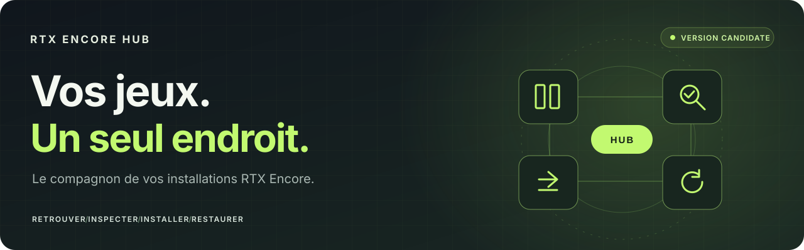
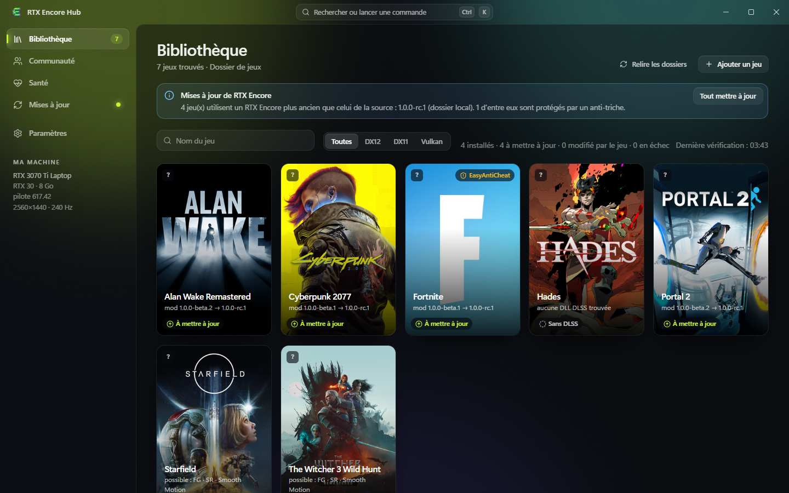
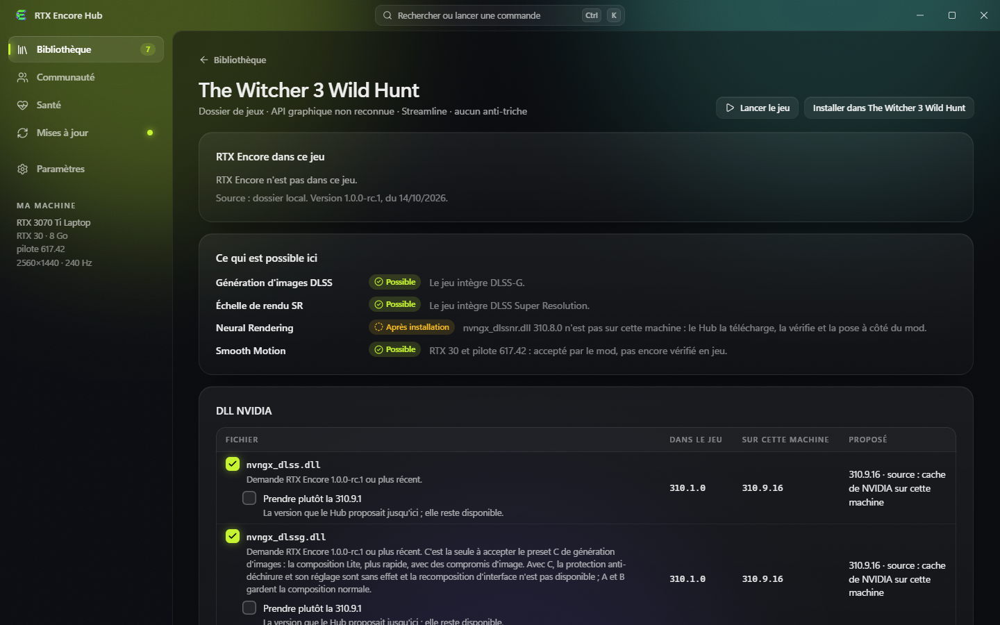
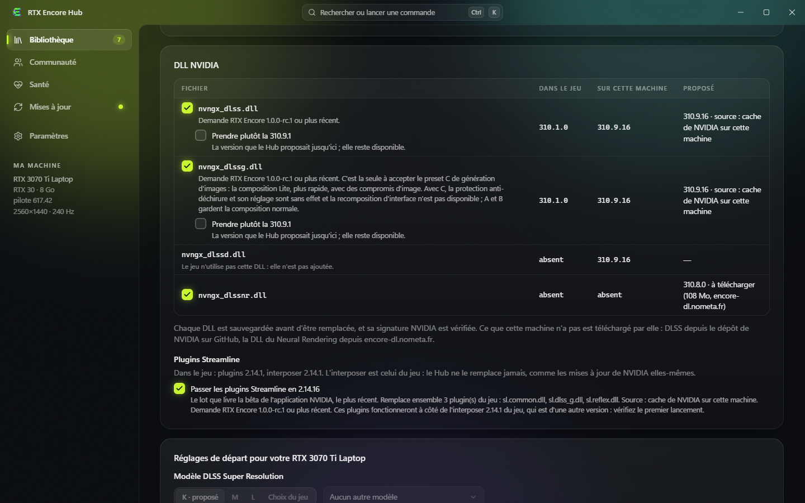

# RTX Encore Hub

### Votre bibliothèque. Vos installations. Votre retour en arrière.

Le compagnon Windows de **[RTX Encore](https://github.com/SilyNoMeta/rtx-encore)**. 
Il trouve vos jeux, installe le mod avec les fichiers NVIDIA qu'il lui faut, tient le tout à jour, et peut toujours remettre un jeu comme il était.

[Site](https://encore.nometa.fr/fr/) · [Guide d'utilisation](docs/USER-GUIDE.fr.md) · [Toutes les versions](https://github.com/SilyNoMeta/rtx-encore-hub/releases) · [Signaler un problème](https://github.com/SilyNoMeta/rtx-encore-hub/issues/new/choose) · **[English](README.md)** · **[简体中文](README.zh-CN.md)**

Gratuit, développé sur du temps personnel. S'il vous est utile, vous pouvez <a href="https://github.com/sponsors/SilyNoMeta">soutenir le projet sur GitHub Sponsors</a> ❤

> [!NOTE]
> **Windows x64.** Ouvrez les [publications](https://github.com/SilyNoMeta/rtx-encore-hub/releases) et téléchargez `RTX-Encore-Hub-Setup-<version>.exe`, ou `RTX-Encore-Hub-Portable-<version>.zip`, qui n'installe rien. L'installateur n'est pas encore signé : Windows peut afficher un avertissement SmartScreen au premier lancement ; chaque publication donne le SHA-256 de son installateur. Le Hub et le mod RTX Encore ont des publications distinctes.

## Hub 1.4.1 : installation Intel et correctifs ZZZ

**Nouveau en 1.4.1 :** installation des composants Intel aux emplacements natifs et proxy par défaut corrigé pour Zenless Zone Zero. [Notes de version](docs/notes/1.4.1.fr.md).

Installez et mettez à jour RTX Encore, gardez ses runtimes cohérents et gérez vos jeux depuis une bibliothèque unique. Le Hub et le mod ont des publications distinctes.

- **Réglages de RTX Encore 1.3.0.** Activez le NR fovéal expérimental du mod et choisissez un préréglage, ou choisissez Smooth Motion V1 ou V2 sur une carte RTX 20. Les deux nécessitent RTX Encore 1.3.0. **Paramètres → Espace utilisé** montre la place prise par le Hub.
- **Journaux du Hub exportables** — Exportez l’activité récente et les erreurs depuis les Réglages ou une fiche en erreur, même si les fiches des jeux ne s’ouvrent pas. Relisez l’archive avant de la partager.
- **Sauvegardes partagées, restauration conservée** — Les octets identiques des originaux et de l’historique ne sont conservés qu’une fois entre les jeux. La migration automatique conserve les réglages et nettoie les anciennes copies vérifiées. Restaurer un état migré nécessite Hub 1.2.4 ou ultérieur.
- **Choix mémorisés** — La fiche jeu conserve les choix de preset, multiplicateur et options. Retour et Appliquer restent accessibles pendant le défilement ; les changements demandent toujours confirmation.
- **Une bibliothèque plus rapide** — Les jeux en cache apparaissent avant la vérification en arrière-plan. Favoris, actions sur les cartes, recherche, mode barre des tâches et choix d’exécutable mémorisé facilitent l’accès aux jeux.
- **Moteurs Intel et runtimes associés** — Choisissez la reconstruction XeSS ou la génération d’images XeFG expérimentales là où le mod les prend en charge. Le Hub installe, vérifie, sauvegarde et restaure leurs fichiers ; leur présence ne prouve pas qu’un moteur fonctionne.
- **NR par passe et entrées HDR** — Réglez chacune des quatre passes NR possibles ou héritez du style global. Les réglages communs d’entrée HDR et d’exposition suivent le moteur de reconstruction choisi ; ils n’activent pas le HDR de l’écran.
- **Diagnostics et profils partagés** — Consultez la page Santé, préparez un diagnostic et partagez des préférences visuelles compatibles par jeu. Les profils partagés restent expérimentaux.

**Toujours disponible depuis le Hub 1.3.0 :** les réglages de RTX Encore 1.3.0 (NR fovéal, Smooth Motion V1 ou V2 sur RTX 20), l’espace utilisé dans les Paramètres, et une maintenance des sauvegardes qui ne répète plus le même avertissement pour un dossier de sauvegarde que le Hub n’a pas créé. OpenNR et le panneau Cyber Engine Tweaks sont partis avec RTX Encore 1.3.0, et leurs réglages avec eux dans le Hub.

**Intel XeSS / XeFG restent très expérimentaux.** Leur compatibilité dépend du mod, du jeu, de l’API graphique et des runtimes. Signalez les problèmes avec une archive de diagnostic relue ; la présence des fichiers ou un multiplicateur demandé ne prouvent pas le rendu effectif.

[Hub 1.4.1](docs/notes/1.4.1.fr.md) · [RTX Encore 1.4.3](https://github.com/SilyNoMeta/rtx-encore/releases/tag/v1.4.3)

Capture de l'application réelle · Interface française · bibliothèque de démonstration faite de dossiers de jeux factices · 14 octobre 2026

## Pourquoi passer par le Hub plutôt que copier les fichiers à la main

| À la main | Avec le Hub |
| :--- | :--- |
| Trouver le dossier du jeu, choisir un nom de proxy libre, copier le bon fichier. | Vos jeux Steam, Epic et GOG sont trouvés tout seuls ; le Hub choisit le nom que le jeu charge vraiment et laisse le leur à ReShade, OptiScaler ou Special K. |
| Chercher les bons fichiers DLSS et Streamline, version par version. | Les DLL DLSS, Ray Reconstruction et génération d'images les plus récentes que le mod admet sont prises pour vous, et les plugins Streamline par jeu complet. L'interposer du jeu n'est jamais remplacé. |
| Trouver vous-même la DLL Neural Rendering de NVIDIA. | `nvngx_dlssnr.dll` 310.9.16, le build exact que le mod exige, est téléchargée, vérifiée et posée à côté du mod. |
| Tout refaire dans chaque jeu à chaque nouvelle version. | **Tout mettre à jour** met à jour le mod, les DLL NVIDIA et les plugins Streamline dans tous les jeux. Le Hub se met aussi à jour lui-même. |
| Tenir vos propres sauvegardes, et espérer. | Chaque fichier remplacé est sauvegardé d'abord ; **Restaurer le jeu** remet tout en place, réglage du pilote compris. |
| Modifier un fichier de réglages à l'aveugle. | Un formulaire explique chaque réglage, grise ce qui n'a pas d'effet sur votre carte, et ne propose que les presets que les DLL de votre jeu prennent. |
| Quelque chose ne va pas et vous ne savez pas pourquoi. | **Lancer et vérifier** observe la première minute du jeu et dit ce qui s'est passé ; un diagnostic est prêt pour un signalement. |

## Ce qu'il fait

| Fonction | Ce que fait le Hub |
| :--- | :--- |
| **Une bibliothèque de jeux** | Trouve les jeux de Steam, Epic et GOG, les dossiers que vous ajoutez, ou un seul jeu par son exécutable. Chaque tuile dit où en est le jeu : non installé, installé, à mettre à jour, modifié par le jeu, en échec. |
| **Une fiche par jeu** | Dit ce que RTX Encore peut y faire sur votre carte et votre pilote (génération d'images, échelle de rendu DLSS, Smooth Motion, Neural Rendering) et pourquoi, et compare les DLL NVIDIA du jeu à ce qu'il propose. |
| **Les bons fichiers NVIDIA** | Prend les versions de DLSS et de Streamline les plus récentes que le RTX Encore du jeu admet, depuis ce que votre machine a déjà ou par téléchargement. Une DLL n'est acceptée qu'avec une signature NVIDIA valide. Vous choisissez les versions une fois pour tous les jeux dans les paramètres, et ce que vous décochez dans un jeu y reste laissé de côté. |
| **Installer avec un retour arrière** | Montre le plan avant d'écrire quoi que ce soit, l'écrit en entier ou pas du tout, et annule une installation interrompue. Les droits d'administrateur ne sont demandés que là où un dossier l'exige, pour cette seule opération. |
| **Mises à jour** | Lit les publications de RTX Encore, avec leurs notes, et met à jour un jeu ou tous. Cherche sa propre nouvelle version et l'installe quand vous le dites ; le téléchargement de la mise à jour est vérifié. |
| **Réglages** | Édite `rtx-encore.jsonc` par un formulaire, garde des jeux de réglages nommés par jeu, propose des réglages de départ pour votre carte, et règle le modèle DLSS Super Resolution, que RTX Encore applique au lancement du jeu. |
| **Santé et sauvegardes** | Lance le jeu, observe sa première minute, et liste chaque état auquel le jeu peut revenir. |

**Ce que le Hub dit d'un jeu est déduit de ses fichiers, de votre carte et de votre pilote.** Ce n'est pas la garantie qu'une fonction marche dans ce jeu, et aucune performance n'est mesurée. La [documentation](https://github.com/SilyNoMeta/rtx-encore) de RTX Encore reste la référence pour le mod.

## Regarder avant d'installer

La fiche d'un jeu dit ce qui est possible avant que vous ne changiez quoi que ce soit, et chaque ligne donne sa raison. Un anti-triche est signalé : rien n'est écrit dans un tel jeu sans votre accord sur le risque.

> [!WARNING]
> Installer un mod dans un jeu protégé par un anti-triche peut empêcher son démarrage ou mettre votre compte en danger, surtout en ligne. Accepter le risque dans le Hub ne rend pas le mod approuvé par un éditeur ou un fournisseur d'anti-triche.

Chaque DLL NVIDIA est montrée avec la version du jeu, la meilleure copie de cette machine, et ce que le Hub propose. Les plugins Streamline sont remplacés par jeu complet ; la fiche dit la version de l'interposer du jeu et vous prévient quand elle diffère.

## Bien démarrer

1. Téléchargez `RTX-Encore-Hub-Setup-<version>.exe` depuis les [publications](https://github.com/SilyNoMeta/rtx-encore-hub/releases) et lancez-le. Il s'installe pour votre compte seulement, sans droits d'administrateur.
2. Ouvrez **Bibliothèque**. Les jeux Steam, Epic et GOG y sont ; ajoutez d'autres dossiers dans **Paramètres**.
3. Ouvrez la fiche d'un jeu, lisez ce qui y est possible, puis **Installer**. Le plan liste chaque fichier avant que rien ne soit écrit.
4. Dans **Santé**, **Lancer et vérifier** démarre le jeu et vous dit comment s'est passée sa première minute.
5. Quand un nouveau RTX Encore sort, **Tout mettre à jour** dans la bibliothèque met à jour tous les jeux.

L'interface suit la langue de Windows : **français, anglais ou chinois simplifié** ; les autres langues reçoivent l'anglais.

Lisez le **[guide d'utilisation](docs/USER-GUIDE.fr.md)** pour les mises à jour, la restauration, l'endroit où le Hub garde ses données et ce qu'il lit sur le réseau.

## Profils de la communauté

Depuis la 1.0.0-rc.2, le Hub lit les profils de la communauté : des réglages par jeu partagés par d'autres joueurs, classés selon la proximité de leur machine avec la vôtre, quelques-uns à la fois, avec des filtres (même carte, Neural Rendering, Smooth Motion…). En importer un montre ce qui changerait, section par section, et peut s'annuler ; publier le vôtre montre exactement ce qui part avant l'envoi. Pas de compte : une clé créée sur votre machine signe ce que vous envoyez. La communauté est expérimentale et peu testée, et elle commence vide.

## À propos de ce dépôt

C'est la maison publique des **téléchargements, de la documentation et des retours de RTX Encore Hub**. Le code source de l'application est tenu ailleurs et n'est pas inclus ici. Les binaires de NVIDIA et les fichiers de jeu ne sont pas stockés dans ce dépôt.

RTX Encore Hub est un projet indépendant, sans lien avec NVIDIA ni avec les éditeurs de jeux. Les illustrations de jeux visibles dans les captures appartiennent à leurs propriétaires. Voir les [mentions du projet](docs/NOTICES.fr.md).
