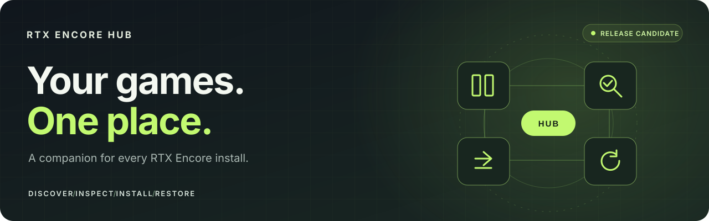
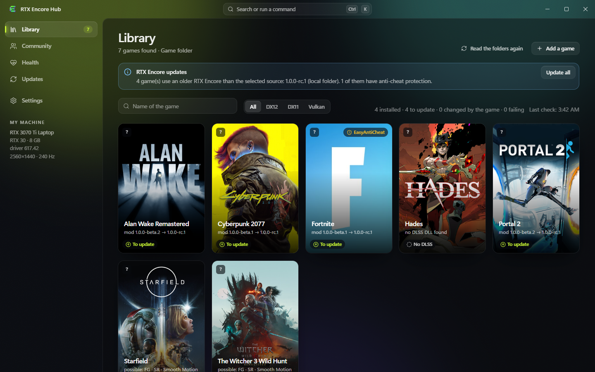
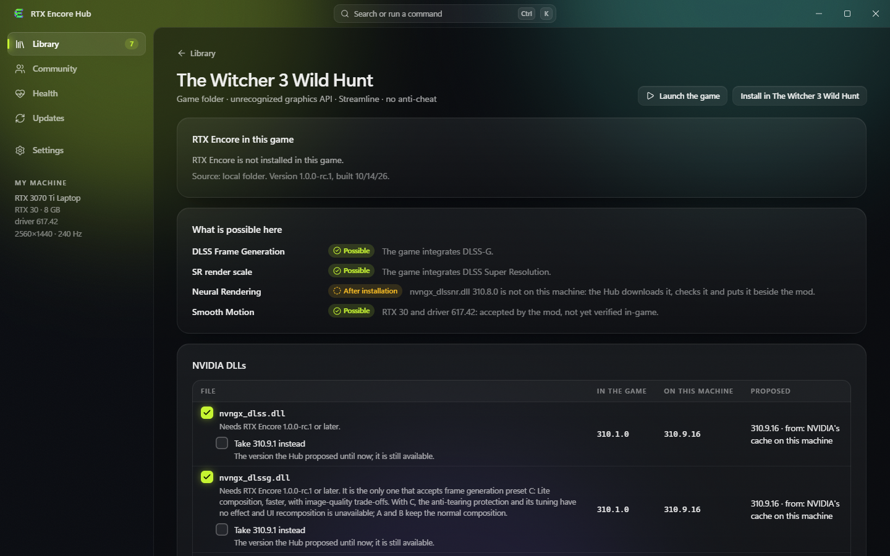
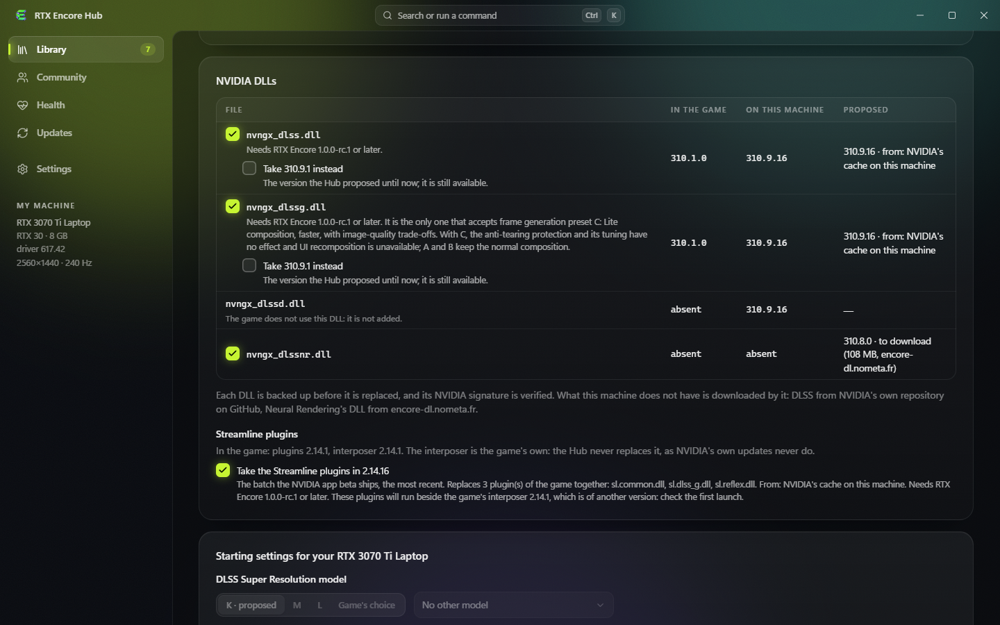

# RTX Encore Hub

### Your library. Your installs. Your way back.

The Windows companion for **[RTX Encore](https://github.com/SilyNoMeta/rtx-encore)**. 
It finds your games, installs the mod with the NVIDIA files it needs, keeps all of it up to date, and can always put a game back as it was.

[Website](https://encore.nometa.fr/) · [User guide](docs/USER-GUIDE.md) · [All releases](https://github.com/SilyNoMeta/rtx-encore-hub/releases) · [Report an issue](https://github.com/SilyNoMeta/rtx-encore-hub/issues/new/choose) · **[Français](README.fr.md)** · **[简体中文](README.zh-CN.md)**

> [!NOTE]
> **Windows x64.** Open the [releases](https://github.com/SilyNoMeta/rtx-encore-hub/releases) and download `RTX-Encore-Hub-Setup-<version>.exe`, or `RTX-Encore-Hub-Portable-<version>.zip`, which installs nothing. The installer is not code-signed yet, so Windows may show a SmartScreen warning the first time; each release gives the SHA-256 of its installer. The Hub and the RTX Encore mod have separate releases.

## 1.2.1

**XeSS / XeFG: VERY EXPERIMENTAL.** Getting this integration working was a particularly difficult and frustrating part of development :) Expect bugs, crashes, visual artifacts and differences between games and graphics APIs. Please report problems: in RTX Encore Hub, open the game’s **Health** page, choose **Prepare a diagnostic**, review the archive for personal information, then attach it to an [RTX Encore issue](https://github.com/SilyNoMeta/rtx-encore/issues/new/choose). Include your engine choices, graphics API and requested multiplier. The Hub does not upload the archive for you.

- **Faster library startup** — Cached games appear immediately while verification runs in the background.
- **RTX Encore 1.2.1** — Menu compatibility improvements, live DLSS/XeSS switching in No Man’s Sky, and broader NVIDIA runtime compatibility.
- **Appropriate controls** — The obsolete NVIDIA provider-policy option is hidden for mod 1.2.1; older mods retain their controls.

- **Library** — Favorites, compact card actions and launch from the card, an optional tray mode that resumes the library, and the title-bar search filtering the library.
- **With RTX Encore 1.2.0** — Smooth Motion on NVIDIA driver 621.01; Force Smooth Motion is gone (Vulkan exclusions are always lifted); DLSS presets and the reconstruction engine apply while the game runs.
- **Intel engines, with their dependencies** — With RTX Encore 1.2, choose XeSS reconstruction or XeFG frame generation where the mod supports them. The Hub installs and verifies the Intel files and their license with the mod; they are backed up and restored in the same operation. Installed files do not establish that an engine is active.
- **Neural Rendering, pass by pass** — For each of the four possible passes, adjust intensity, local tone, local structure, skin structure and the character mask, or inherit the global setting. Setting intensity to zero still runs the pass and does not remove its cost.
- **HDR input and exposure** — The common `srHdr` and `srAutoExposure` controls follow the chosen reconstruction engine. Both default to the game and require a restart. HDR input does not enable HDR on the display or convert SDR to HDR.
- **Find the right game** — The global search opens games directly. When the executable is uncertain, the game page offers candidates and remembers your choice. You can return to automatic selection.
- **Useful diagnostics** — Health reports the frame-generation provider and runtime compatibility. The diagnostic archive includes the mod’s text logs, settings and a game-folder listing. Review it before sharing; the Hub does not upload it.

Intel, common-input and per-pass NR settings require mod 1.2.0-beta.1 or later. Mod 1.2.1 no longer uses the NVIDIA provider-policy setting, so the Hub hides it; older mods retain their supported controls. XeFG remains experimental and depends on the mod, graphics API, game and runtime. A requested multiplier does not prove displayed frames.

[Release notes](docs/notes/1.2.1.md) · [1.2.0-beta.1 notes](docs/notes/1.2.0-beta.1.md)

Real application capture · English interface · demonstration library of stand-in game folders · 14 October 2026

## Why use the Hub rather than copy files by hand

| By hand | With the Hub |
| :--- | :--- |
| Find the game folder, pick a proxy name that is free, copy the right file. | Your Steam, Epic and GOG games are found by themselves; the Hub picks the name the game really loads and leaves ReShade, OptiScaler or Special K theirs. |
| Hunt for the right DLSS and Streamline files, version by version. | The latest DLSS, Ray Reconstruction and frame generation DLLs the mod admits are taken for you, and the Streamline plugins as a matched set. The game's own interposer is never replaced. |
| Find NVIDIA's Neural Rendering DLL yourself. | `nvngx_dlssnr.dll` 310.9.16, the exact build the mod requires, is downloaded, verified and put beside the mod. |
| Redo it all in every game at each new version. | **Update all** updates the mod, the NVIDIA DLLs and the Streamline plugins in every game. The Hub updates itself too. |
| Keep your own backups, and hope. | Every replaced file is backed up first; **Restore game** puts everything back, driver setting included. |
| Edit a settings file and guess. | A form explains every setting, greys what has no effect on your card, and offers only the presets your game's DLLs take. |
| Something goes wrong and you do not know why. | **Launch and verify** watches the game's first minute and says what happened; a diagnostic is ready for a report. |

## What it does

| Feature | What the Hub does |
| :--- | :--- |
| **One game library** | Finds the games of Steam, Epic and GOG, the folders you add, or a single game by its executable. Each tile says where the game stands: not installed, installed, to update, changed by the game, failing. |
| **A page for every game** | Says what RTX Encore can do there on your card and driver (frame generation, DLSS render scale, Smooth Motion, Neural Rendering) and why, and compares the game's NVIDIA DLLs with what it proposes. |
| **The right NVIDIA files** | Takes the most recent DLSS and Streamline versions the game's RTX Encore admits, from what your machine already has or from a download. A DLL is accepted only with a valid NVIDIA signature. You choose the versions once for every game in Settings, and what you untick in one game stays left alone there. |
| **Install with a way back** | Shows the plan before anything is written, writes it whole or not at all, and undoes an install that was interrupted. Administrator rights are asked only where a folder needs them, for that one operation. |
| **Updates** | Reads the releases of RTX Encore, with their notes, and updates one game or all of them. Looks for its own new version and installs it when you say so; the downloaded update is verified. |
| **Settings** | Edits `rtx-encore.jsonc` through a form, keeps named sets of settings per game, proposes starting settings for your card, and sets the DLSS Super Resolution model, which RTX Encore applies when the game starts. |
| **Health and backups** | Starts the game, watches its first minute, and lists every state the game can be put back to. |

**What the Hub says of a game is deduced from its files, your card and your driver.** It is not a certification that a feature works in that game, and it measures no performance. RTX Encore's own [documentation](https://github.com/SilyNoMeta/rtx-encore) remains the reference for the mod.

## Look before you install

The page of a game says what is possible before you change anything, and each line gives its reason. An anti-cheat is said so: nothing is written in such a game without your word on the risk.

> [!WARNING]
> Installing a mod in a game an anti-cheat protects can block its startup or put your account at risk, especially online. Accepting the risk in the Hub does not make the mod approved by a publisher or an anti-cheat provider.

Each NVIDIA DLL is shown with the version in the game, the best copy this machine has, and what the Hub proposes. The Streamline plugins are replaced as a set; the page says the version of the game's interposer and warns you when it differs.

## Getting started

1. Download `RTX-Encore-Hub-Setup-<version>.exe` from the [releases](https://github.com/SilyNoMeta/rtx-encore-hub/releases) and run it. It installs for your account only, without administrator rights.
2. Open **Library**. Steam, Epic and GOG games are there; add other folders under **Settings**.
3. Open a game's page, read what is possible there, and press **Install**. The plan lists every file before anything is written.
4. Under **Health**, **Launch and verify** starts the game and tells you how its first minute went.
5. When a new RTX Encore is out, **Update all** in the library updates every game.

The interface follows the language of Windows: **English, French or Simplified Chinese**; other languages get English.

Read the **[user guide](docs/USER-GUIDE.md)** for updates, restoration, where the Hub keeps its data and what it reads on the network.

## Community profiles

Since 1.0.0-rc.2, the Hub reads the community's profiles: settings per game shared by other players, ranked by how close their machine is to yours, a few at a time, with filters (same card, Neural Rendering, Smooth Motion…). Importing one shows what would change, section by section, and can be undone; publishing yours shows exactly what is sent before it is. There is no account: a key made on your machine signs what you send. The community is experimental and lightly tested, and it starts empty.

## About this repository

This is the public home of **RTX Encore Hub downloads, documentation and feedback**. The application source is maintained separately and is not included here. NVIDIA binaries and game files are not stored in this repository.

RTX Encore Hub is an independent project, unaffiliated with NVIDIA or game publishers. Game artwork visible in screenshots belongs to its respective owners. See the [project notices](docs/NOTICES.md).
