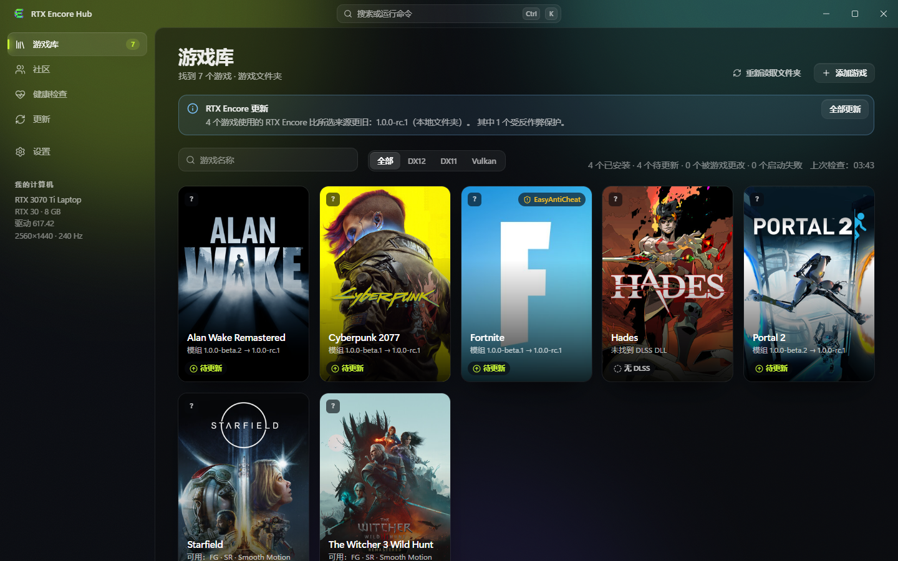
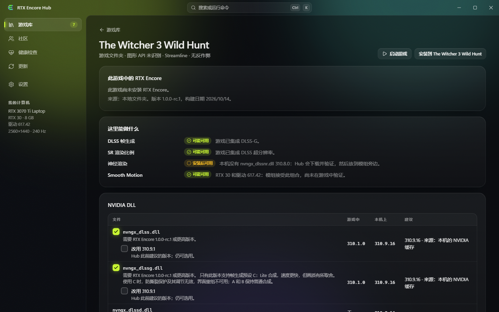
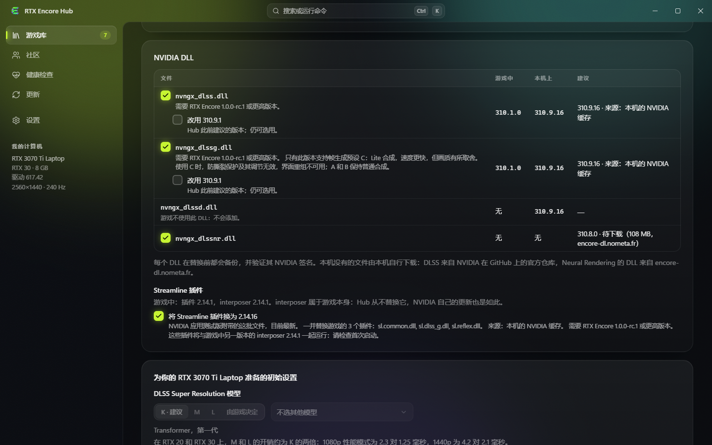

# RTX Encore Hub

### 您的游戏库。您的安装。您的回退之路。

**[RTX Encore](https://github.com/SilyNoMeta/rtx-encore)** 的 Windows 配套应用。 
它会找到您的游戏，连同所需的 NVIDIA 文件一起安装模组，让一切保持最新，并且随时可以把游戏恢复原状。

[网站](https://encore.nometa.fr/zh/) · [用户指南](docs/USER-GUIDE.zh-CN.md) · [所有版本](https://github.com/SilyNoMeta/rtx-encore-hub/releases) · [报告问题](https://github.com/SilyNoMeta/rtx-encore-hub/issues/new/choose) · **[English](README.md)** · **[Français](README.fr.md)**

> [!NOTE]
> **Windows x64。** 请打开[发布页面](https://github.com/SilyNoMeta/rtx-encore-hub/releases)并下载 `RTX-Encore-Hub-Setup-<version>.exe`，或无需安装的 `RTX-Encore-Hub-Portable-<version>.zip`。安装程序尚未进行代码签名，因此首次运行时 Windows 可能显示 SmartScreen 警告；每个发布版本都会给出安装程序的 SHA-256。Hub 与 RTX Encore 模组分别发布。

## Hub 1.3.1：更安全的运行库更新

**1.3.1 更新：**为 WRC Generations 等旧游戏提供更安全的 Streamline 与 NVIDIA 运行库更新，继续禁止不兼容的组合。[版本说明](docs/notes/1.3.1.zh-CN.md)。

从统一游戏库安装和更新 RTX Encore，管理配套运行库与游戏。Hub 与模组分别发布。

- **RTX Encore 1.3.0 的设置。** 开启模组的实验性中央优先 NR 并选择预设，或在 RTX 20 显卡上选择 Smooth Motion V1 或 V2。两者都需要 RTX Encore 1.3.0。**设置 → 存储空间** 显示 Hub 所占空间。
- **Hub 日志导出** — 即使无法打开游戏页面，也能从设置或出错页面导出近期 Hub 活动和错误。分享前请检查压缩包。
- **共享备份，保留还原能力** — 多个游戏的原始文件和历史记录中，相同字节仅保存一次。自动迁移保留设置并清理已验证的旧副本。还原迁移后的状态需要 Hub 1.2.4 或更高版本。
- **记住选择** — 游戏页面会记住预设、倍率和选项。滚动时仍可使用返回和应用；修改仍需确认。
- **更快的游戏库** — 先显示缓存游戏，再在后台验证。收藏、卡片操作、搜索、托盘模式和记住的可执行文件选择让游戏更易访问。
- **Intel 引擎及配套运行库** — 在模组支持的场景中选择实验性 XeSS 重建或 XeFG 帧生成。Hub 安装、验证、备份和还原其文件；文件存在不能证明引擎已激活。
- **逐轮 NR 与 HDR 输入** — 分别设置最多四轮 NR，或继承全局风格。共用 HDR 输入与曝光设置跟随所选重建引擎，不会启用显示器 HDR。
- **诊断与共享配置** — 查看健康页面、生成诊断并分享兼容的逐游戏画面偏好。共享配置仍为实验性功能。

**继续保留 Hub 1.3.0 的功能：** RTX Encore 1.3.0 的设置（中央优先 NR、RTX 20 的 Smooth Motion V1 或 V2）、设置中的存储空间，以及备份维护不再因并非 Hub 创建的备份文件夹而重复同一警告。OpenNR 和 Cyber Engine Tweaks 面板随 RTX Encore 1.3.0 移除，Hub 中的相关设置也一并移除。

**Intel XeSS / XeFG 仍高度实验性。** 兼容性取决于模组、游戏、图形 API 和运行库。请附上检查后的诊断包报告问题；文件存在或请求的倍率不能证明实际渲染成功。

[Hub 1.3.1](docs/notes/1.3.1.zh-CN.md) · [RTX Encore 1.3.1](https://github.com/SilyNoMeta/rtx-encore/releases/tag/v1.3.1)

真实应用截图 · 简体中文界面 · 由替身游戏文件夹组成的演示游戏库 · 2026 年 10 月 14 日

## 为什么使用 Hub，而不是手动复制文件

| 手动操作 | 使用 Hub |
| :--- | :--- |
| 找到游戏文件夹，选一个未被占用的代理名称，复制正确的文件。 | 自动找到您的 Steam、Epic 和 GOG 游戏；Hub 会选择游戏真正会加载的名称，并把 ReShade、OptiScaler 或 Special K 的名称留给它们。 |
| 逐个版本地寻找合适的 DLSS 和 Streamline 文件。 | 自动采用模组支持的最新 DLSS、Ray Reconstruction 和帧生成 DLL，并整套更换 Streamline 插件。游戏自身的 interposer 从不被替换。 |
| 自己去找 NVIDIA 的 Neural Rendering DLL。 | `nvngx_dlssnr.dll` 310.9.16，也就是模组要求的那个确切构建，会被下载、验证并放在模组旁边。 |
| 每出一个新版本，就在每个游戏里重做一遍。 | **全部更新**会更新所有游戏中的模组、NVIDIA DLL 和 Streamline 插件。Hub 自身也会自动更新。 |
| 自己保存备份，然后听天由命。 | 每个被替换的文件都会先备份；**还原游戏**会把一切恢复原状，包括驱动设置。 |
| 修改设置文件全靠猜。 | 表单会解释每一项设置，把对您的显卡无效的设置变灰，并且只提供游戏 DLL 支持的预设。 |
| 出了问题却不知道原因。 | **启动并验证**会观察游戏的第一分钟并说明发生了什么；还可以准备一份用于报告的诊断。 |

## 它能做什么

| 功能 | Hub 的作用 |
| :--- | :--- |
| **一个游戏库** | 找到 Steam、Epic 和 GOG 的游戏、您添加的文件夹，或通过可执行文件添加单个游戏。每个磁贴都会显示游戏的状态：未安装、已安装、待更新、被游戏修改、失败。 |
| **每个游戏一个页面** | 说明 RTX Encore 在您的显卡和驱动上能做什么（帧生成、DLSS 渲染比例、Smooth Motion、Neural Rendering）以及原因，并把游戏的 NVIDIA DLL 与它的建议进行比较。 |
| **合适的 NVIDIA 文件** | 采用游戏中的 RTX Encore 所支持的最新 DLSS 和 Streamline 版本，来源是本机已有的文件或下载。只有带有效 NVIDIA 签名的 DLL 才会被接受。您可以在设置中为所有游戏统一选择版本，在某个游戏中取消勾选的内容会在该游戏中保持不变。 |
| **可回退的安装** | 写入任何内容之前先显示方案，要么完整写入，要么完全不写，并撤销被中断的安装。只有在文件夹需要时才会请求管理员权限，且仅用于这一次操作。 |
| **更新** | 读取 RTX Encore 的发布版本及其说明，更新单个游戏或全部游戏。查找 Hub 自身的新版本，并在您同意时安装；更新带有签名。 |
| **设置** | 通过表单编辑 `rtx-encore.jsonc`，为每个游戏保存命名的设置组合，为您的显卡建议起始设置，并设置 DLSS Super Resolution 模型，由 RTX Encore 在游戏启动时应用。 |
| **健康与备份** | 启动游戏，观察其第一分钟，并列出游戏可以还原到的每个状态。 |

**Hub 对一个游戏的说明是根据其文件、您的显卡和驱动推断出来的。** 这并不保证某项功能在该游戏中可用，也不测量任何性能。RTX Encore 自己的[文档](https://github.com/SilyNoMeta/rtx-encore)仍是模组的参考依据。

## 安装之前先看清楚

在您做出任何更改之前，游戏页面会说明这里能做什么，每一行都给出原因。反作弊会被明确指出：未经您确认风险，不会在这样的游戏中写入任何内容。

> [!WARNING]
> 在受反作弊保护的游戏中安装模组，可能导致游戏无法启动或使您的账号面临风险，尤其是在线游戏。在 Hub 中接受风险并不意味着模组获得了发行商或反作弊提供商的认可。

每个 NVIDIA DLL 都会显示游戏中的版本、本机已有的最佳副本以及 Hub 的建议。Streamline 插件整套更换；页面会显示游戏 interposer 的版本，并在版本不同时提醒您。

## 快速开始

1. 从[发布页面](https://github.com/SilyNoMeta/rtx-encore-hub/releases)下载 `RTX-Encore-Hub-Setup-<version>.exe` 并运行。它只为您的账户安装，不需要管理员权限。
2. 打开**游戏库**。Steam、Epic 和 GOG 的游戏已经在那里；可在**设置**中添加其他文件夹。
3. 打开某个游戏的页面，查看这里能做什么，然后点击**安装**。写入任何内容之前，方案会列出每一个文件。
4. 在**健康检查**中，**启动并验证**会启动游戏，并告诉您它的第一分钟情况如何。
5. RTX Encore 发布新版本时，游戏库中的**全部更新**会更新所有游戏。

界面跟随 Windows 的语言：**英语、法语或简体中文**；其他语言使用英语。

关于更新、还原、Hub 存放数据的位置以及它在网络上读取的内容，请阅读**[用户指南](docs/USER-GUIDE.zh-CN.md)**。

## 社区配置

自 1.0.0-rc.2 起，Hub 可以读取社区配置：其他玩家分享的各游戏设置，按其机器与您机器的接近程度排序，每次显示一部分，并可筛选（相同显卡、Neural Rendering、Smooth Motion……）。导入前会逐节显示将要更改的内容，并且可以撤销；发布您自己的配置时，发送前会完整显示将要发送的内容。无需账号：由您机器上生成的密钥为您发送的内容签名。社区仍是实验性的、测试较少，并且一开始是空的。

## 关于本仓库

这里是 **RTX Encore Hub 下载、文档和反馈**的公开主页。应用的源代码在别处维护，不包含在此处。本仓库不存放 NVIDIA 的二进制文件和游戏文件。

RTX Encore Hub 是一个独立项目，与 NVIDIA 或游戏发行商无关。截图中可见的游戏美术作品归其各自所有者所有。请参阅[项目声明](docs/NOTICES.zh-CN.md)。
